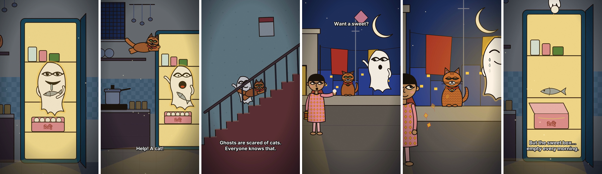

<h1 align="center">Hi, I'm Restadul 👋</h1>

  <b>Game developer · Animator · Creator of the Rongpat cartoon style</b> 
  <i>I build games, cartoons and the tools that make them.</i>

## About me

I'm a game developer and animator. I love telling stories, whether players live them in a game or watch them in a cartoon. My visual style, **Rongpat**, is a hand-drawn look I created, inspired by Bengali folk art (Kalighat pat, Gond, Madhubani) and modern Bengali illustration.

## What I build

| 🎮 Games | 🎬 Animation | 🛠️ Tools |
|---|---|---|
| Developing my own games, from idea to gameplay to art | Funny Bangla and English cartoon stories for YouTube Shorts | **Rangput Animation Maker**, a free offline cartoon maker for Windows |

- 🌱 Currently: building new chapters of *Pupu's World*, and adding automatic voices and animal animation to Rangput
- 💬 Ask me about: game ideas, storytelling, character design, animation pipelines
- 🤝 Open to: collaborations on games and animated stories

## Featured projects

### 🎮 Games

#### [Pupu's World (পুপুর জগৎ)](https://github.com/arestadul-max/pupus-world) &nbsp;`demo`

A Bengali story platformer set in rural Bangladesh, drawn in my Rongpat style. Play as Pupu, a curious boy who slips through his sleeping house, the river ghat and the village school, with his cat Mishti and memories of his Dadu.

  

| | |
|---|---|
|  |  |
|  |  |

| | |
|---|---|
| 🕹️ Plays in the browser on PC and phone, and installs like an app | 🌐 Full English or full Bangla |
| 🤫 Sneaking, hiding, chases and surprise actions | 🧮 Dadu's maths game with a new puzzle every time |

➡️ **[Play now](https://arestadul-max.github.io/pupus-world/)** · **[About the game](https://github.com/arestadul-max/pupus-world#readme)**

### 🎬 Animation

  
   🏏 <i>The Last Ball</i>: a cricket story made with Rangput Animation Maker

  
   👻 <i>The Fish-Thief Ghost (Mechho Bhoot)</i>: my first Rongpat animation

#### [Rangput Animation Maker](https://github.com/arestadul-max/Rangput-Animation-Maker) &nbsp;`pre-release`

Write a story in a spreadsheet, add voice recordings, double-click, and get a finished vertical cartoon video. No internet, no AI service, no subscription.

| | |
|---|---|
| 🎭 40 ready-made characters and 36 places | 🦴 Automatic rigging for your own characters and objects |
| 😄 19 automatic expressions that react to the story | 🗣️ Lip-sync, music, sound effects, Bangla and English subtitles |

  

➡️ **[Download for Windows](https://github.com/arestadul-max/Rangput-Animation-Maker/releases)** · **[Read the guide](https://github.com/arestadul-max/Rangput-Animation-Maker#readme)** · **[Report a problem](https://github.com/arestadul-max/Rangput-Animation-Maker/issues)**

## Tools I use

## Find me

📬 Questions or ideas about Rangput Animation Maker? Open an [issue](https://github.com/arestadul-max/Rangput-Animation-Maker/issues).
<!-- Add your links here later, for example:

-->

---

<i>Stories you can watch, and stories you can play.</i>

